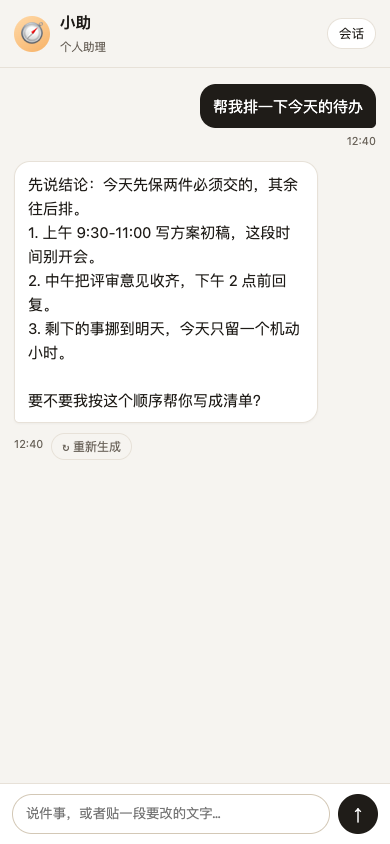
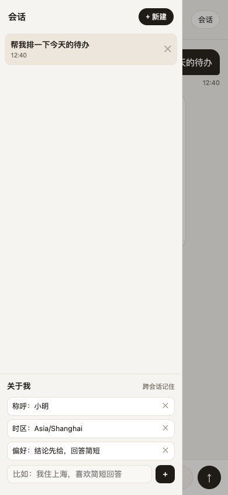
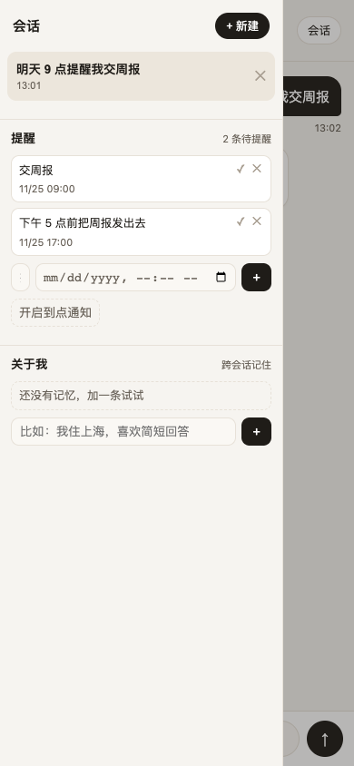

# 小助 · 懒人包

[](https://github.com/rchau8502/lazy-assistant/actions/workflows/ci.yml)

一个下载就能用的个人 AI 助理：聊天、记事、写东西、做决定、到点提醒。
自带流式回复、停止/重新生成、多会话、跨会话长期记忆、定时提醒、联网搜索，手机打开像 App。

| 主界面 | 「关于我」记忆面板 | 提醒 |
| --- | --- | --- |
|  |  |  |

## 三步开始

1. **下载**：点右上角绿色 `Code` → `Download ZIP`，解压；或 `git clone https://github.com/rchau8502/lazy-assistant.git`。
2. **启动**：
   - macOS：双击 `start.command`（第一次会弹权限提示，右键 → 打开）
   - Windows：双击 `start.bat`
   - Linux / 服务器：`bash start.sh`
3. **选模型**：终端里按提示选 1–4，填 key（本地模型不用填），浏览器会自动打开 http://127.0.0.1:8010 。

只想换个模型、不想重跑向导：直接改 `.env` 里的 `LLM_BASE_URL` / `LLM_MODEL` / `LLM_API_KEY`，重启即可。

## 接哪种模型都行

都是 OpenAI 兼容接口，换地址和模型名就行：

| 服务 | `LLM_BASE_URL` | `LLM_MODEL` | key |
| --- | --- | --- | --- |
| DeepSeek | `https://api.deepseek.com` | `deepseek-chat` | 必填 |
| OpenAI | `https://api.openai.com/v1` | `gpt-4o-mini` | 必填 |
| 本地 Ollama | `http://127.0.0.1:11434/v1` | `qwen2.5:7b` | 留空 |
| 本地 LM Studio | `http://127.0.0.1:1234/v1` | 你加载的模型名 | 留空 |
| 任意兼容网关 | 网关地址 | 模型名 | 看网关要求 |

### 用本地模型（Ollama）

```bash
# 1. 安装 Ollama：https://ollama.com/download
# 2. 拉一个模型（7B 起步，内存 16G 建议 7B，32G 可以 14B）
ollama pull qwen2.5:7b
# 3. 确认服务在跑
curl http://127.0.0.1:11434/v1/models
```

然后启动小助，向导里选 3。本地模型不联网、不要 key，但小模型的中文表达和多步推理会明显弱于云端大模型，适合「不想把内容发出去」的场景。

## 手机上用

服务跑在电脑上，手机连同一个 Wi-Fi：

1. 看启动时终端打印的地址，形如 `http://192.168.1.23:8010`。
2. iPhone / iPad 用 Safari 打开，点分享 → **添加到主屏幕**；Android 用 Chrome → 添加到主屏幕。
3. 以后点图标就是全屏，和 App 一样。

想在外面也能用，把这套放到有公网 IP 的服务器或 NAS 上（见下面 Docker）。**注意：本应用没有登录功能，暴露到公网前一定要加一层反向代理密码或只走内网/Tailscale。**

## 两层记忆

| | 存在哪 | 放什么 | 怎么改 |
| --- | --- | --- | --- |
| 关于我（资料） | `prompts/profile.md` | 时区、称呼、长期偏好 | 编辑文件，重启 |
| 关于我（记忆） | 本地 SQLite `facts` 表 | 会变的事实、最近的事 | 抽屉里点 + / ✕，立即生效 |

两层都会注入 system prompt，跨会话有效。条数上限 `MAX_FACTS`（默认 60，超出删最旧）。

对话太长时还有第三层：超过 `CONTEXT_TOKEN_LIMIT`（默认 2000）就把旧对话压成备忘存进会话，旧原文删除——这是「这次对话的摘要」，和跨会话的事实是两回事。

## 提醒与联网搜索

**提醒**：直接说「明天 9 点提醒我交周报」，小助会换算时间并自己建提醒；也可以在抽屉「提醒」里手动加。

- 到点检查是页面每 20 秒轮询一次：**页面或 PWA 开着才会响**，第一次用点一下「开启到点通知」允许系统通知。关掉页面不响（真要后台推送得接系统通知服务，不在这个版本里）。
- `ENABLE_TOOLS=0` 可整体关掉工具调用。

**联网搜索**：想要新闻、价格、天气这类实时信息时，小助会调用搜索再回答，答案里带来源。

- 需要 `TAVILY_API_KEY`（[tavily.com](https://tavily.com) 注册后有免费额度），填进 `.env` 重启即可。
- 不填也能用，只是问实时信息时它会直说搜不了，不会凭空编。

## 数据与隐私

- 所有对话、备忘、记忆都在本地 `data/chatbot.db`（SQLite 单文件），不上传任何服务器。
- key 只在服务端 `.env`，不会下发到前端；`.gitignore` 已排除 `.env` 和 `data/`。
- 备份就是复制 `data/` 目录。
- 没有登录与权限控制，默认只适合自己或家人用。

## Docker / NAS

```bash
cp .env.example .env      # 填 key
docker compose up -d
```

访问 http://127.0.0.1:8010 。数据挂在 `./data`，删容器不丢。

## 常见问题

**点开一片空白 / 连不上？** 先看终端有没有报错；端口被占用就改 `.env` 里的 `PORT` 再启动。

**提示没配置 key？** 只有 DeepSeek / OpenAI 官方接口强制要 key；用本地模型时把 `LLM_API_KEY` 留空即可。

**回复很慢或报 429？** 云端高峰期限流，换时段或改本地模型；本地模型慢是显存/内存不够，换小一号的模型。

**想换助手性格？** 改 `prompts/system.md`（人设和规则）与 `.env` 里的 `BOT_NAME` / `BOT_EMOJI` / `BOT_ACCENT` 等品牌项。

**到点没提醒？** 提醒只在页面/PWA 开着时轮询触发，先确认页面没关、并点过「开启到点通知」。真要在关页面时也响，得加后台推送服务。

**搜索不能用？** 检查 `.env` 里的 `TAVILY_API_KEY` 是否填了、服务是否重启；免费额度用完也会失败。

## 目录

```
app.py                    后端：接口、SSE 流式、SQLite、压缩、长期记忆、提醒、搜索、页面渲染
setup.py                  配置向导（写 .env）
start.sh / start.command  一键启动（mac/Linux）
start.bat                 Windows 一键启动
prompts/system.md         人设与回答规则
prompts/profile.md        「关于我」资料，按自己情况改
static/index.html         手机聊天页 + 提醒/记忆面板
static/manifest.webmanifest  PWA 配置
tests/mock_upstream.py    假模型上游，无 key 也能自测
tests/smoke_test.py       端到端测试
data/chatbot.db           运行时生成，你的数据都在这里
```

## 自测（不需要真 key）

```bash
python3 -m venv .venv && .venv/bin/pip install -r requirements.txt
.venv/bin/uvicorn --app-dir tests mock_upstream:app --port 8011
LLM_BASE_URL=http://127.0.0.1:8011 CONTEXT_TOKEN_LIMIT=200 \
  TAVILY_BASE_URL=http://127.0.0.1:8011 TAVILY_API_KEY=test \
  .venv/bin/uvicorn app:app --port 8012
BASE_URL=http://127.0.0.1:8012 .venv/bin/python tests/smoke_test.py
```

覆盖：流式、落库、断连保存半截、压缩成备忘、重新生成、长期记忆增删查重、对话里设提醒、到期查询与去重、联网搜索、删除会话。

## License

MIT
